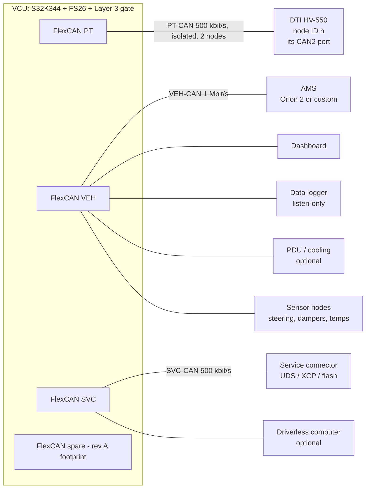

# VCU CAN Implementation and Module Interface Specification
**Companion to:** *Formula Student EV — VCU Final Design (FSG 2026)* · **Date:** 4 Oct 2026

**Legend:** ✅ verified in a source I actually opened (listed in §13) · ⚠️ not verified or inferred, so **confirm on the bench / in the manual / with officials before freezing** · 🔧 design decision (a choice, not a fact or a rule value).

---

## 0. Research basis, and what it changes

### 0.1 Honest scope statement

You asked me to check what other teams "did and validated". What I found are **public designs and repositories from competing teams** (Berkeley FEB, FSLART, UBC Formula Electric, Yale Bulldog Racing, Black Forest Formula Team, a Politecnico di Torino thesis). I found **no published verification evidence** (test reports, fault-injection results) for any of them. "Used by other teams" is therefore a reason to trust a *pattern*, not proof that it is *correct*. Everything in §10 exists so that you generate your own evidence.

### 0.2 What I verified

| Topic | Finding | Source |
|---|---|---|
| DTI CAN framing | 29-bit extended ID: **packet ID above, node ID in the low 8 bits**; node `0xFF` addresses *all* devices on the bus | DTI CAN description V1.3 ✅ |
| DTI commands | `0x00` duty, `0x01` current, `0x02` brake current, `0x03` ERPM, `0x04` position, `0x0A/0x0B` relative current/brake, **`0x0C/0x0D` max AC current/brake, `0x0E/0x0F` max DC current/brake** | V1.3 ✅ |
| DTI scaling | Current ×1000 (A), relative ×100000, duty ×100000, position ×1 000 000, ERPM unscaled; 32-bit value in `data[0..3]` | V1.3 ✅ |
| DTI timeout | If no control command arrives within the interval set in DTI Tool (App Settings → General → Timeout), **the motor free-runs and control stops** until the next command | V1.3 ✅ |
| DTI status | Enabled by "Send CAN Status"; rate set by "CAN Status Rate". Four packets: ERPM/duty/Vin · AC & DC current · controller temp/motor temp/fault code · Id/Iq | V1.3 ✅ |
| DTI fault codes | 0 none, 1 over-V, 2 under-V, 3 DRV, 4 abs over-current, 5 controller over-temp, 6 motor over-temp, 7 sensor wire, 8 sensor general | V1.3 ✅ |
| DTI newer map | A team library lists **more messages than V1.3**: `Drive_Enable` command, digital output commands, throttle/brake signal, digital inputs, drive-enable flag, limit flags (DC current, power, RPM min/max, temperatures), and a **`CAN_map_version`** field | Yale `bdr-can-ids` ✅ |
| DTI ports | HV-500/550: **CAN1 = firmware/configuration, CAN2 = interfacing**; 120 Ω required at both ends; 24 V suppressors on CAN pins | HV-500 manual ✅ |
| DTI protocol lineage | Command/status scheme is VESC-derived (extended IDs, int32 values, scaled by 1000) | VESC `comm_can.md` ✅ |
| Orion BMS 2 CAN | Two isolated CAN 2.0B ports, 125/250/500/1000 kbps, up to **10 custom broadcast messages** (ID, length, byte/bit order, scaling, period all programmable), OBD2 request mode with **default ECU ID `0x7E3`**, optional cell broadcast (cell ID, voltage, resistance, open-circuit voltage, checksum) | orionbms.com ✅ |
| Orion units | OBD2 SOC is in 0.5 % steps (value/2) | orionbms.com ✅ |
| Rules, SCS | T11.9.2: SCS single failures (open circuit, short to ground, short to supply for analog, out-of-range, **data corruption, loss and delay of messages via timeouts**) must give the safe state | FS Rules 2026 (excerpt) ✅ |
| Rules, APPS over digital link | T11.8.13 (quoted in the FS UK supplement): if *any* digital data transmission carries the APPS signal, the ESF must list failure modes, detection strategy and tests, including corruption, message loss and time-outs | FS UK 2026 supplement ✅ |
| Rules, AMS | EV5.8.10: AMS signals are SCS. EV6.1.11: all signals influencing the SDC are SCS | FS Rules 2026 (excerpt) ✅ |
| Rules, direct connection | T1.3.1: direct connection means not routed through any common PCB | FS Rules 2026 v1.1 ✅ |
| Rules, regen | T6.1.13: first 90 % of brake pedal travel may regenerate; T6.3.1: brake light on iff hydraulic *or* electric brake actuated | FS Rules 2026 v1.1 ✅ |

### 0.3 Patterns other teams use (and why I adopted them)

| Team | Pattern | Adopted as |
|---|---|---|
| **Berkeley FEB** (public CAN library) | Messages defined once, **DBC generated from definitions, C pack/unpack generated from the DBC, CI job fails if generated files are stale**; ID ranges reserved per subsystem; vendor DBCs merged in; heartbeat frames with 64 individual error flags | §11, §4.1, §6.1 |
| **FSLART (Lisbon) VCU** | 3 CAN buses (data 1 Mbps, powertrain 500 kbps, autonomous 500 kbps); codecs generated from DBC with `cantools`; **50 ms** APPS-frame timeout, **200 ms** autonomous-command timeout; telemetry rotated across frames at 10 Hz | §2, §9 |
| **UBC Formula Electric** | Firmware update over CAN (`canup`), single consolidated firmware repo | §6.9 |
| **Yale Bulldog Racing** | DTI + Orion 2 pair; Orion read in OBD2 request mode and parsed big-endian; library keyed on a DTI map version | §6.2 |
| **Politecnico di Torino thesis** | A safety "error byte" that must be *received*: absence puts the system in the error state (fail-safe by silence) | §5, §9 |

### 0.4 Corrections and new findings that change the VCU design document

| # | Issue | Fix |
|---|---|---|
| C1 | **Bus names collide.** §3 of the design calls the powertrain bus "CAN1" and the vehicle bus "CAN2"; §3.1 says the inverter is on "CAN2" and Layer 3 gates "CAN2 TXD". The DTI also has its *own* CAN1/CAN2 ports. Three different meanings of "CAN2". | Rename by **function**: `PT-CAN` (inverter only), `VEH-CAN`, `SVC-CAN`. The VCU's PT-CAN connects to the **DTI's CAN2**. The Layer 3 gate acts on **PT-CAN TXD**. |
| C2 | DTI timeout action was ⚠️. | V1.3 says **free-run** ✅. Re-verify on your R4 firmware (the document I found is older than the HV-550 R4 manual). |
| C3 | **Gating TXD recessive makes the VCU's own CAN controller see bit errors.** If firmware keeps transmitting while the gate holds the line recessive, TEC climbs to bus-off, auto-recovery restarts, and it repeats. | Firmware reads the gate state (GPIO readback) and **stops requesting TX** when the gate is open; bus-off auto-recovery disabled on PT-CAN; recovery is a deliberate state (§7.4). Add to fault matrix. |
| C4 | **DTI limits are writable over CAN** (`0x0C–0x0F`) and `0xFF` broadcasts to every node. A rogue frame can raise a current limit. | PT-CAN is a **2-node bus, no gateway**; VCU has a **TX whitelist** (§6.1.4); never emits node `0xFF`; DTI-Tool limits remain the last line and are re-read after every power-up. Whether CAN-set limits persist across a reset or revert is ⚠️ (test T-DTI-6). |
| C5 | **Orion's default OBD2 ECU ID `0x7E3` collides with a UDS physical-address range `0x7E0–0x7EF`.** | Reserve `0x7E3/0x7EB` for the Orion; UDS node map in §6.9. UDS lives on SVC-CAN anyway. |
| C6 | The VCU→inverter torque request is a digital transmission of an APPS-derived value. | Treat T11.8.13 as applying: the ESF must describe corruption, loss and time-out detection on PT-CAN (§9, §10). |
| C7 | DTI **status frame IDs and byte layout are not confirmed** by anything I could open (V1.3 gives packet IDs `0x00–0x03` and bit ranges that can be read two ways; newer map versions add messages). | **Do not hard-code from the PDF.** Table-driven map + bench capture + golden-capture regression test (§6.1.5). |

---

## 1. CAN design principles

1. **CAN carries information; hardware carries safety.** Nothing on CAN can open the SDC or satisfy a rule that needs direct connection (T1.3.1). CAN can only *remove* torque, never *add* it.
2. **Fail-safe by silence.** Every safety-relevant message has a supervised timeout. A missing frame is a fault, never "last value held".
3. **One source of truth.** A DBC per bus, generated from a definitions file; firmware, logger, dashboard, test tools and docs all consume generated artefacts. CI fails if they drift (Berkeley FEB pattern).
4. **Classic CAN for everything safety-relevant.** The DTI and Orion are classic CAN 2.0. CAN FD is optional on SVC-CAN only (bulk flashing).
5. **Separate buses by failure domain**, not by convenience: noisy inverter, slow vehicle bus, service/driverless bus.
6. **Design every signal for the receiver that has to survive a lie**: rolling counter + CRC on VCU-owned frames, plausibility on received values, defined fallbacks.

---

## 2. Network architecture



| Bus | Rate | Nodes | Transceiver | Purpose | Gateway to other buses |
|---|---|---|---|---|---|
| **PT-CAN** | 500 kbit/s classic 🔧 (FSLART powertrain precedent ✅; DTI baud is set in DTI Tool ⚠️) | VCU + inverter(s) only | Isolated (ISO1042-Q1 class) | Torque/current command, inverter status | **None.** VCU is the only reader/writer. |
| **VEH-CAN** | 1 Mbit/s classic 🔧 (FSLART data-bus precedent ✅) | VCU, AMS, dash, logger, PDU, sensor nodes | TJA1463 | Vehicle data, AMS limits, dash | VCU re-publishes selected signals, never raw frames |
| **SVC-CAN** | 500 kbit/s classic, FD optional 🔧 | VCU, service connector, driverless computer | TJA1463 | UDS, XCP, flashing, DV commands | VCU only; diag session required |
| spare | — | — | footprint only | Dedicated AMS bus if the AMS proves noisy or its harness is long | — |

**Why the AMS is on VEH-CAN and not PT-CAN:** the inverter bus has the highest noise and is the one Layer 3 silences. Keeping the AMS off it means a gate trip or an inverter-side bus fault does not also blind the VCU to AMS current limits. If rev A bring-up shows AMS link trouble, populate the spare channel.

---

## 3. Physical layer and bit timing

### 3.1 Wiring rules (apply to all three buses)

- Twisted pair 120 Ω nominal, **shielded on PT-CAN** and on any run beside the motor phase cables; shield grounded at **one end** (VCU side) 🔧.
- Linear topology; **stubs ≤ 30 cm** on VEH-CAN at 1 Mbit/s 🔧. No star.
- Termination only at the two physical ends. VCU end: split termination 2×60 Ω + 4.7 nF (design §4.5). Far end: 120 Ω in the connector backshell. **Power-off check: 60 Ω ±5 % between CANH and CANL**, recorded in the harness checklist.
- **Inverter side:** the DTI manual requires 120 Ω at both ends ✅. Whether the DTI contains internal termination is ⚠️. Do not assume. Fit an external 120 Ω at the DTI pigtail and measure.
- Keep CAN harness ≥ 10 cm from phase cables (the Chinese-OEM guide I found uses 0.5 m for HV lines; that is a vehicle-scale figure, so use "as far as packaging allows, crossing at 90°") ⚠️.
- CAN carries **no power** on the same connector pair; the supply for any CAN node comes from its own protected LV branch.
- Isolated transceiver on PT-CAN: the isolation barrier helps against inverter-side faults, but the LV ground is shared with the car, so it is **not** a common-mode noise cure (design §3.1 already says this).

### 3.2 Bit timing (example, verify in the S32 configuration tool)

FlexCAN protocol-engine clock source and frequency for your S32K344 clock tree are ⚠️. Example assuming an **80 MHz** CAN engine clock:

| Rate | Prescaler | Time quanta/bit | Sync | Prop+Seg1 | Seg2 | SJW | Sample point |
|---|---|---|---|---|---|---|---|
| 500 kbit/s | 10 | 16 | 1 | 12 | 3 | 3 | 81.25 % |
| 1 Mbit/s | 5 | 16 | 1 | 12 | 3 | 3 | 81.25 % |

Target sample point 80–87.5 %; clock tolerance ≤ 0.5 % (crystal, not RC). Check with an oscilloscope CAN decode that all nodes agree, and measure the actual sample point with a bus analyser.

### 3.3 Transceiver conditions

- Normal mode only. No sleep/wake use (the VCU is powered through the LVMS; design §4.2).
- Isolated transceiver supply from an isolated DC/DC or the transceiver's integrated supply; decouple per datasheet.
- ESD array and common-mode choke at each connector (design §4.5).

---

## 4. Identifier plan and message catalogue

### 4.1 Allocation rules

- **11-bit standard IDs** on VEH-CAN and SVC-CAN; the DTI uses **29-bit extended IDs** on PT-CAN ✅.
- **Lower ID = higher priority.** Safety-relevant first.
- Reserved ranges per subsystem (the FEB approach ✅). Never reuse; deprecate instead.

| VEH-CAN ID range | Owner | Content |
|---|---|---|
| `0x001–0x00F` | VCU | Emergency / global fault broadcast |
| `0x010–0x01F` | AMS | State, limits, pack, heartbeat |
| `0x020–0x02F` | VCU | State, heartbeat, torque summary |
| `0x030–0x03F` | Dash | Driver inputs (non-critical) |
| `0x100–0x1FF` | VCU | Telemetry and dash feed |
| `0x200–0x2FF` | Sensor nodes | Steering, damper, temperature |
| `0x300–0x3FF` | PDU / cooling | Status and commands |
| `0x400–0x4FF` | Logger / time | Time sync, logger status |
| `0x7E0–0x7EF` | Diagnostics | UDS (`0x7E3/0x7EB` **reserved for Orion OBD2**) |

SVC-CAN: `0x500–0x5FF` driverless; `0x7E0–0x7FF` UDS; XCP IDs `0x7C0/0x7C1` 🔧.

### 4.2 Message catalogue (VCU-owned and VCU-consumed)

Periods are 🔧 starting points; tune from bus-load measurement (§8).

**VEH-CAN**

| ID | Name | Dir (from VCU) | Period | Length | Safety class | Content |
|---|---|---|---|---|---|---|
| `0x010` | AMS_STATE | RX | 20 ms | 8 | **A** | AMS state, fault flags, "AMS OK", counter, CRC |
| `0x011` | AMS_LIMITS | RX | 20 ms | 8 | **A** | Discharge current limit (DCL), charge current limit (CCL) |
| `0x012` | AMS_PACK | RX | 20 ms | 8 | B | Pack voltage, pack current, SOC |
| `0x013` | AMS_TEMPV | RX | 100 ms | 8 | B | Min/max cell temperature, min/max cell voltage |
| `0x01F` | AMS_HB | RX | 100 ms | 8 | B | Heartbeat + error flags |
| `0x020` | VCU_STATE | TX | 10 ms | 8 | B | State machine, torque request %, torque limit %, flags (R2D, TS active, SDC sense bits), fault class, counter, CRC |
| `0x021` | VCU_HB | TX | 100 ms | 8 | C | CRC, counter, **32 error flags**, 16-bit free-running heartbeat counter (FEB's 64-flag pattern ✅ does not fit next to CRC and counter in 8 bytes) |
| `0x023` | VCU_VERSION | TX | 1000 ms | 8 | C | CRC, counter, SW major/minor/patch (8 bits each), calibration CRC-16 |
| `0x022` | VCU_POWER | TX | 20 ms | 8 | B | DC voltage, DC current, power estimate, limiter state |
| `0x030` | DASH_IN | RX | 50 ms | 4 | C | Map select, TC level; **can only lower torque/power** |
| `0x101–0x106` | VCU_TELEM1..6 | TX | 20 ms | 8 | C | Pedal %, brake pressures, wheel speeds, IMU, temperatures (rotate across frames as FSLART does ✅) |
| `0x110` | VCU_DASH | TX | 50 ms | 8 | C | Speed, SOC, lap/state text codes, warnings |
| `0x400` | TIME_SYNC | TX | 1000 ms | 8 | C | VCU uptime + UTC-ish counter for logger alignment |

**PT-CAN (DTI native, extended IDs)** — see §6.1.

**SVC-CAN**

| ID | Name | Dir | Content |
|---|---|---|---|
| `0x7E0 / 0x7E8` | UDS VCU request / response | RX / TX | ISO-TP |
| `0x7DF` | UDS functional request | RX | Read-only services |
| `0x7C0 / 0x7C1` | XCP CMD / RES | RX / TX | Calibration on stands |
| `0x500–0x50F` | AS_CMD / AS_STATUS | RX / TX | Driverless interface (§6.8) |

---

## 5. Frame protection and supervision (VCU-owned frames)

The DTI has no counter or CRC field; its integrity relies on the CAN CRC plus time-outs (§6.1). VCU-owned and custom-AMS frames carry both.

### 5.1 Layout (classic CAN, 8 bytes)

| Byte | Content |
|---|---|
| 0 | **CRC-8** |
| 1 | bits 0–3 **rolling counter** (0–14; 15 reserved, see below) · bits 4–7 message-specific state |
| 2–7 | payload |

Counter wraps 0→14 and skips 15 (so an all-ones stuck frame is never valid, as in AUTOSAR E2E Profile 1) 🔧.

### 5.2 CRC

CRC-8/SAE-J1850: polynomial `0x1D`, init `0xFF`, final XOR `0xFF` (same parameters the MATLAB example in my search used ✅; standard check value for ASCII `"123456789"` is **`0x4B`**, add that as a unit test). Computed over `{DATA_ID, byte1 … byte7}`, where `DATA_ID` is a per-message constant that is **not** the CAN ID (so a frame re-sent under a different ID fails).

```c
#include <stdint.h>
#include <stddef.h>

static uint8_t crc8_j1850(const uint8_t *p, size_t n)
{
    uint8_t crc = 0xFFu;
    for (size_t i = 0; i < n; i++) {
        crc ^= p[i];
        for (int b = 0; b < 8; b++) {
            crc = (crc & 0x80u) ? (uint8_t)((crc << 1) ^ 0x1Du) : (uint8_t)(crc << 1);
        }
    }
    return (uint8_t)(crc ^ 0xFFu);
}

/* Frame CRC = crc8( DATA_ID || byte[1..7] ) */
uint8_t frame_crc(uint8_t data_id, const uint8_t f[8])
{
    uint8_t tmp[8];
    tmp[0] = data_id;
    for (int i = 1; i < 8; i++) tmp[i] = f[i];
    return crc8_j1850(tmp, 8);
}
```

(For speed, replace the bit loop with a 256-entry table; keep the bitwise version as the unit-test oracle.)

### 5.3 Receiver state machine (one instance per supervised message)

| State | Entered when | Output to application |
|---|---|---|
| `INIT` | boot / after timeout | signals **invalid**, defaults applied |
| `VALID` | N consecutive good frames (N=2 for class A, 🔧) | signals valid |
| `INVALID` | CRC fail, DLC ≠ expected, or counter delta ∉ {1,2} | signals invalid; **one** bad frame invalidates class A |
| `TIMEOUT` | no frame within timeout | signals invalid; timeout flag latched per §9 |

Timeout = **3 × nominal period** for class A, rounded to the 1 ms task grid 🔧. Allow counter delta 1 or 2 (one lost frame tolerated) only for class B/C; class A uses delta = 1 strictly.

The application never reads a raw signal; it reads `{value, valid}`. Every consumer has a documented fallback for `valid == false` (§9).

---

## 6. Module-by-module specification

### 6.1 DTI HV-550 inverter (PT-CAN)

#### 6.1.1 Connection

- VCU PT-CAN ↔ **DTI CAN2** (interfacing port) ✅. DTI CAN1 goes to a service connector for DTI Tool/firmware and is **never** on the VCU bus ✅ (design §3.1).
- Node ID `n` (unique per inverter; avoid `0x00` and `0xFF`) 🔧. Example below: `n = 0x16`.
- DTI Tool settings to confirm: *Send CAN Status* enabled, *CAN Status Rate* (start at 100 Hz), *Timeout* (start at 40 ms), baud rate ⚠️.

#### 6.1.2 Commands (VCU → DTI): ID = `(packet_id << 8) | node`

| Packet | Name | ID for `n=0x16` | Data | Used? |
|---|---|---|---|---|
| `0x01` | Set current | `0x00000116` | int32 = amps × 1000 | **Yes** (drive; sign = torque direction ✅) |
| `0x02` | Set brake current | `0x00000216` | int32 = amps × 1000; sign ignored ✅ | **Candidate for regen** (§6.1.6) |
| `0x0C/0x0D` | Max AC / AC brake current | `0x00000C16`, `0x00000D16` | int32 ×1000 | Only to *reduce* limits, if T-DTI-6 passes |
| `0x0E/0x0F` | Max DC / DC brake current | `0x00000E16`, `0x00000F16` | int32 ×1000 | Same |
| `0x00, 0x03, 0x04, 0x0A, 0x0B` | Duty, ERPM, position, relative | — | — | **Never** (blocked in driver) |
| newer maps | Drive enable, digital outputs | ⚠️ ID from your map version | — | Optional, see §6.1.7 |

Byte order of the int32: VESC-style big-endian (`data[0]` = MSB) ⚠️ high confidence from lineage ✅, confirm by capture.
Units: *current* is phase current as the DTI defines it for its limits (DTI quotes 388 Arms / 550 Apk) ⚠️. Test T-DTI-2 establishes whether 100 A commanded equals 100 Apk or 100 Arms.

#### 6.1.3 Status (DTI → VCU), per V1.3 ✅ content, layout ⚠️

| Packet | Content | Scaling per V1.3 |
|---|---|---|
| 0 | ERPM (int32), duty (int16), input voltage (int16, V) | duty ×1000 |
| 1 | AC current, DC current (int16 each) | ×10, sign = motoring (+) / generating (−) |
| 2 | Controller temp, motor temp (int16), fault code (uint8) | ×10 |
| 3 | Id, Iq (int32 each) | ×100 |

ERPM → mechanical RPM = ERPM / pole pairs ✅.
The V1.3 PDF gives bit ranges (e.g. "Input voltage 63–48, duty 47–32, ERPM 31–0") that can be read as most-significant-first *or* in transmit order. **Do not guess.** The proven procedure is §6.1.5.

#### 6.1.4 VCU transmit rules (code-enforced)

1. **Whitelist of TX IDs** on the PT-CAN peripheral: only packets `0x01`, `0x02` (and, if approved, `0x0C–0x0F` with reduce-only logic) for the configured node. Anything else is dropped and logs a class-A fault. Unit test: fuzz the TX API and assert no frame outside the whitelist leaves the driver.
2. Node `0xFF` is a compile-time error.
3. Command value is clamped to `[-I_regen_max, +I_drive_max]` and rejected if non-finite.
4. Period **5 ms** (200 Hz) 🔧; DTI timeout **≥ 6× period but ≤ 50 ms** so a stalled VCU stops the motor within one rule-relevant interval 🔧.
5. No command is sent while Layer 3 gate is open or state ≠ `DRIVE` (a zero-current frame is still sent in `TS_ACTIVE`/`R2D_SOUND` only if the inverter needs a heartbeat ⚠️; otherwise stay silent and rely on timeout).

```c
#define DTI_CMD_SET_CURRENT   0x01u
#define DTI_CMD_SET_BRAKE_CUR 0x02u

static inline uint32_t dti_id(uint8_t cmd, uint8_t node) { return ((uint32_t)cmd << 8) | node; }

static void put_i32_be(uint8_t *d, int32_t v)
{
    d[0] = (uint8_t)((uint32_t)v >> 24); d[1] = (uint8_t)((uint32_t)v >> 16);
    d[2] = (uint8_t)((uint32_t)v >> 8);  d[3] = (uint8_t)((uint32_t)v);
}

bool dti_send_current(uint8_t node, float amps)
{
    if (!(amps == amps) || node == 0xFFu || node == 0x00u) return false;   /* NaN / bad node */
    if (amps >  I_DRIVE_MAX_A) amps =  I_DRIVE_MAX_A;
    if (amps < -I_REGEN_MAX_A) amps = -I_REGEN_MAX_A;
    uint8_t d[4];
    put_i32_be(d, (int32_t)(amps * 1000.0f));
    return can_pt_tx_whitelisted(dti_id(DTI_CMD_SET_CURRENT, node), /*ext*/true, d, 4);
}
```

#### 6.1.5 Bench procedure to fix the status layout (before any firmware depends on it)

1. Connect VCU or a USB-CAN adapter to DTI CAN2 with the inverter's logic supply only, status enabled.
2. Log with `candump` / `cantools monitor`; list the distinct extended IDs and their rates. Record ID base, DLC, and the DTI firmware and **CAN map version**.
3. Cross-check against DTI Tool's live values: vary DC input voltage with a lab supply (Vin field), turn the motor shaft by hand (ERPM sign and scale), unplug the motor temperature sensor (fault code), apply a small known current in T-DTI-2 (Id/Iq, AC current).
4. Write the result into `dti_r4.dbc`, commit the capture file as the **golden capture**, and add a CI test that decodes it and asserts every field.
5. Add a runtime check: if the DTI reports a map version other than the one in the DBC, raise a class-B warning and refuse to enter `DRIVE` until acknowledged in service mode.

#### 6.1.6 Regen

Two candidate mechanisms: negative *Set current* or *Set brake current* ✅ (the PDF says sign is ignored for brake current). Which one produces generator-mode torque with the AC/DC brake limits applied is ⚠️; T-DTI-5 decides. Rules: regen current counts toward the TS current limit (EV2.2.3 per the changelog ✅); the VCU must drive the brake light whenever electric braking is active (T6.3.1 ✅, design §4.6); regen must only act within the pedal range T6.1.13 allows.

#### 6.1.7 Layer 3 gate interaction

- Gate forces PT-CAN TXD recessive. The inverter sees silence, then free-runs after its timeout ✅.
- Firmware reads back the gate state; **when open, `can_pt_tx` is disabled in software** (fix for C3) and the FlexCAN controller is held in Freeze/disabled state. Re-enable only after gate closes **and** state machine returns to a state that allows commands.
- If your DTI map version has a CAN *Drive Enable* command ⚠️, treat it as a software enable only: it never replaces the hardware enable path or the timeout.

#### 6.1.8 RX supervision (DTI → VCU)

| Item | Rule |
|---|---|
| Status frame age | > 30 ms (3 × 10 ms) ⇒ inhibit torque, class A |
| Fault code ≠ 0 | class A, latched |
| Vin < min or > max | class A (also configured inside DTI) |
| Id/Iq vs command | Plausibility: measured Iq within ±10 % (or ±10 A) of commanded after 20 ms settle; sustained violation (> 50 ms) ⇒ class A. This detects "inverter ignoring or mis-scaling commands" 🔧 |
| Map version | see §6.1.5 |

#### 6.1.9 Characterisation tests (add to the Phase-1 list)

| ID | Test | Pass criterion / output |
|---|---|---|
| T-DTI-1 | Status IDs, layout, map version | Golden capture + DBC |
| T-DTI-2 | Current-command scale (Arms vs Apk), command-to-Iq latency | k_I table, latency in ms |
| T-DTI-3 | Control timeout: stop sending, measure time to zero torque and behaviour (free-run vs brake) | Matches DTI Tool setting |
| T-DTI-4 | Logic-supply loss, CAN unplug, bus-off, encoder loss | Fault code + torque state |
| T-DTI-5 | Regen: negative *Set current* vs *Set brake current*; limits honoured | Chosen mechanism |
| T-DTI-6 | Do CAN-set max current values persist after inverter reset? Can a CAN frame *raise* a limit above DTI Tool's value? | Documented; decides whether `0x0C–0x0F` are used |
| T-DTI-7 | Broadcast `0xFF` and wrong node ID behaviour (bench only, no HV, no motor) | Documented; confirms whitelist matters |

---

### 6.2 AMS / BMS (VEH-CAN)

**Role:** the AMS is a hardware safety device that opens the SDC. The VCU is a *consumer* of its CAN data for torque limiting and display. **No SDC element routes through the VCU PCB** (T1.3.1 ✅).

**Two implementation paths:**

*A. Orion BMS 2 (commercial):*
- Configure **custom broadcast messages** on its CAN port in the Orion utility: ID, length, byte/bit order, scaling and period are all user-programmable, up to 10 messages ✅. Use these rather than OBD2 polling: broadcast is simplest, no VCU request needed ✅; OBD2 polling adds a request/response dependency.
- Mirror §4.2 IDs `0x010–0x013` with period 20 ms for state/limits. Orion has no VCU-style counter ⇒ **supervise by timeout and by value plausibility** (and see whether your Orion version offers a checksum field on custom frames ⚠️).
- Defaults to avoid: OBD2 ECU ID `0x7E3` ✅ (kept out of UDS range, C5). SOC via OBD2 is in 0.5 % units ✅; custom messages use your own scaling.
- Note the Orion CAN1 and CAN2 are isolated from each other ✅; put the VCU link on one and the charger/diagnostics on the other.

*B. Custom AMS:* use the §5 frame layout (CRC + counter) so the VCU can apply class-A supervision.

**VCU use of AMS data:**

| Signal | Use | If invalid / timeout |
|---|---|---|
| DCL (discharge current limit) | Upper bound of the limiter chain (design §5.4) | **Treat as 0 A** after timeout ⇒ torque derates to zero (class A) |
| CCL (charge limit) | Regen current ceiling | Treat as 0 A ⇒ regen off |
| AMS OK / state | Needed to enter and stay in `DRIVE` (design §5.3) | Class A, `TORQUE_INHIBIT` |
| Pack V, I, SOC | Power estimate cross-check, dash | Class B: use inverter Vin/DC current instead |
| Min/max cell V/T | Dash, derating | Class B |

Rule hooks: AMS signals are SCS (EV5.8.10 ✅). That sentence is about the AMS's own measurement and shutdown signals; the CAN copy the VCU reads is an *information* path, but implement it with timeout + corruption detection anyway.

---

### 6.3 Dashboard (VEH-CAN)

- **Hard-wired, not CAN:** R2D button, TS-activate button (debounced in hardware, design §4.4). CAN must never be the only path for an action that energises the TS or enters R2D.
- **CAN inputs (class C):** map select, traction-control level, display page. A CAN input may **only lower** torque or power (design §5.4; same principle as T11.8.14 ✅ in the FS UK text).
- **CAN outputs from VCU:** state, speed, SOC, temperatures, warnings, fault code table index.
- **Timeout:** 250 ms without `DASH_IN` ⇒ fall back to the default (safest) map; driver sees "DASH LINK" warning.
- Dash must also show: software version + calibration CRC (design §5.9), TSAL/R2D state mirror (not a replacement for the TSAL).

---

### 6.4 Data logger and telemetry (VEH-CAN)

- **Logger is listen-only.** Either configure its controller in silent mode or use a transceiver with TX disabled. A logger that can transmit is a babbling-node risk; it also must not ACK-spam.
- **Wireless telemetry gateway:** one-way (bus → radio). No radio-to-CAN path on the car. If bidirectional telemetry is wanted later, route it through the VCU on SVC-CAN with a diagnostic session and security access.
- Time alignment: use `TIME_SYNC` (§4.2) and log VCU uptime; do not rely on the logger clock.
- Log the **raw PT-CAN** by tapping the VCU, not by adding a node to PT-CAN (keeps PT-CAN at 2 nodes).

---

### 6.5 PDU / cooling controller (VEH-CAN, optional)

Your design drives pumps and fans from the VCU's smart high-side switches. If a separate PDU is added:

| Message | Dir | Notes |
|---|---|---|
| `0x300 PDU_STATUS` | RX, 20 ms | Per-channel current, fault flags, rail voltage; class C |
| `0x301 PDU_CMD` | TX, 50 ms | Pump/fan duty request; PDU **defaults to cooling ON** (100 %) if the command times out in 500 ms, because a silent controller must not stop cooling |

Brake light and R2D buzzer stay on the VCU (their rule behaviour must not depend on a CAN node).

---

### 6.6 Sensor nodes (VEH-CAN)

| Sensor | Path | CAN? | Class | Notes |
|---|---|---|---|---|
| APPS ×2 | Analog direct to VCU ADCs | **No** | SCS (T11.8.7 ✅) | Must stay off CAN; if ever digitised remotely, T11.8.13 applies ✅ |
| Brake pressure ×2 | Analog direct | No | B | BSPD has its own path |
| Wheel speed ×4 | eMIOS capture direct | No | B | |
| IMU | SPI on VCU board | No | B | |
| Steering angle | CAN (or analog) | Optional | C if used for TV/dash only | Timeout 100 ms ⇒ torque vectoring disabled (class B). Never used by anything that can raise torque |
| Damper pots, tyre/brake temps | CAN sensor nodes | Yes | C | 100 Hz max; frame = ID, 4×int16 |

Sensor-node frame template (🔧): `ID(0x200+node) | counter(4b)+status(4b) | 3×int16 |CRC`. Use §5 where the data feeds torque vectoring.

---

### 6.7 SDC, BSPD, IMD, BOTS, TSMS, TSAL (no CAN)

These are **intentionally not on CAN**. The VCU observes them through isolated high-impedance inputs (design §4.4). A CAN copy of their state may be broadcast for the dash and logger, derived from those inputs.

---

### 6.8 Driverless computer (SVC-CAN, optional "DV-ready")

I did not read T14/T15 line by line for this document ⚠️. Interface principles that hold regardless of the exact rule wording:

- Accept `AS_CMD` **only** when the autonomous-mode precondition is sensed in hardware (ASMS state input); in manual mode the VCU ignores AS_CMD entirely (the exact rule wording on ASMS and manual mode is ⚠️ unverified: confirm in the driverless rules).
- Frame: §5 layout; payload = torque or speed request, steering request, mission ID. **Timeout 50–100 ms** ⇒ zero torque (FSLART used 200 ms ✅; choose the lower end for a brake-critical system) 🔧.
- Autonomous commands pass through the same torque limiter chain and are **reduce-only relative to limits**; AS torque requests are still bounded by the same current/power limits.
- The Emergency Brake System and the ASSI are independent hardware (that they are independent of the VCU is ⚠️ unverified here: confirm in the driverless rules); VCU CAN is not part of the EBS trigger path.
- Add a `VCU_AS_STATUS` frame (state, ready, fault) at 20 ms with §5 protection.

---

### 6.9 Service, diagnostics and bootloader (SVC-CAN)

| Function | Detail |
|---|---|
| **UDS** (ISO 14229 over ISO-TP 15765-2) | Services: `0x10` session, `0x11` reset, `0x19` DTC, `0x22/0x2E` data, `0x27` security access, `0x31` routine (calibration), `0x34–0x37` download (bootloader). Session policy: **write/flash only if vehicle speed = 0, TS inactive (precharge not done), and state = `LV_READY` or lower** |
| UDS addressing | VCU `0x7E0/0x7E8`; Dash `0x7E1/0x7E9`; PDU `0x7E2/0x7EA`; **`0x7E3/0x7EB` reserved (Orion OBD2 default ✅)**; Logger `0x7E4/0x7EC` 🔧 |
| **XCP on CAN** | Calibration and measurement on stands only; gated by the same session rule; disabled in the release build used at the event |
| **Bootloader** | A/B image with CRC/signature and rollback (design §5.9). Firmware-over-CAN precedent exists (UBC `canup` ✅). Flash only via SVC-CAN, never PT-CAN |
| **DTI firmware/config** | Via DTI CAN1/DTI-COM only ✅. Export the DTI Tool configuration, store hash in Git, re-verify after any flash |

---

## 7. VCU CAN software architecture

### 7.1 Layers

```
Application (SWC)   Torque · Limits · State · Fault mgr · Diag
        ▲ signals {value, valid}                 │ commands
RTE / Signal layer  generated from DBC: pack/unpack, scaling, invalid defaults
        ▲                                        │
E2E / Supervision   CRC · counter · timeout state machines (§5.3)
        ▲                                        │
PDU router          per-bus whitelist, routing table, rate limiter
        ▲                                        │
CAN driver (HAL)    FlexCAN via NXP RTD: MB config, filters, bus-off, error counters
```

### 7.2 Receive path (FlexCAN)

- One **dedicated message buffer per safety-critical RX ID** (AMS_STATE, AMS_LIMITS, DTI status packets, DASH_IN) with exact-match individual masks ⚠️ (feature names per S32K3 reference manual; confirm the register names in your RTD version).
- **RX FIFO** (ID filter table) for bulk/telemetry traffic.
- RX interrupt only timestamps and copies frames into a lock-free ring; decoding and E2E checks run in the **1 ms task** (design §5.2). No decoding in ISR.
- Every RX frame increments a per-ID age counter reset; age is checked each ms.

### 7.3 Transmit path

- **One dedicated TX mailbox per periodic message**, enqueued from a fixed schedule slot (jitter budget ≤ 1 ms).
- Use **TX-confirmation** flags as a liveness monitor: no confirmation for a periodic frame within 2 periods ⇒ class A on PT-CAN (the bus is dead or the VCU is stuck), class B elsewhere.
- Do not queue: if the previous instance of a periodic frame has not been sent, **abort and replace** it (stale torque must never be transmitted late).

### 7.4 Error handling and bus-off

| Condition | Action |
|---|---|
| TEC or REC > 96 (error warning) | Log, class C |
| Error passive | PT-CAN: class A (torque inhibit); VEH/SVC: class B |
| **Bus-off** | **Auto-recovery disabled** (FlexCAN `CTRL1[BOFFREC]` ⚠️ verify). PT-CAN: class A, torque 0. Recovery is a deliberate step: `TORQUE_INHIBIT` ⇒ controller re-init ⇒ wait 100 ms ⇒ 3 good status frames ⇒ allow `DRIVE` again after pedal < 5 % |
| Gate open (Layer 3) | TX disabled in software (C3); no error counters expected |
| Counter freeze / CRC fail burst | per §5.3 |

Log TEC/REC, bus-off count and peak bus load to FRAM each 100 ms task (design §5.8).

### 7.5 Build and tooling

- DBC files in Git, one per bus: `pt_dti_r4.dbc`, `veh.dbc`, `svc.dbc`, plus `ams_orion.dbc` if used.
- Generator script (Python + `cantools`, **version pinned**, FEB pins cantools 39.4.13 ✅) produces: C pack/unpack, signal tables, timeout tables, a markdown message list for the ESF.
- CI job `generate --check` fails on stale generated files ✅ (FEB). Add: ID-collision check across buses, bus-load check (§8), unit tests for CRC (check value `0x4B`), codec round-trip tests, **golden-capture decode test** for DTI.
- MISRA C:2012 applies to hand-written code; generated code is reviewed and covered by the round-trip tests.

---

## 8. Bus-load and timing budget

**Frame length** (8 data bytes, including inter-frame space, worst-case bit stuffing):
- Standard 11-bit: 111 bits nominal, **135** worst case.
- Extended 29-bit: 131 bits nominal, **160** worst case.

**PT-CAN @ 500 kbit/s**

| Traffic | Frames/s | Worst-case bits/s |
|---|---|---|
| DTI status ×4 packets @ 100 Hz | 400 | 64 000 |
| VCU Set current @ 200 Hz | 200 | 32 000 |
| Optional max-current frames @ 20 Hz | 20 | 3 200 |
| **Total** | 620 | **99 200 ≈ 20 % of 500 kbit/s** |

Target ≤ 40 % worst case on PT-CAN 🔧. Doubling the status rate to 200 Hz gives ≈ 33 %, still acceptable.

**VEH-CAN @ 1 Mbit/s (estimate)**

| Traffic | Frames/s | Worst-case bits/s |
|---|---|---|
| AMS ×4 @ 50 Hz + HB | 210 | 28 350 |
| VCU_STATE @ 100 Hz, POWER @ 50 Hz, HB @ 10 Hz | 160 | 21 600 |
| VCU_TELEM ×6 @ 50 Hz, DASH @ 20 Hz | 320 | 43 200 |
| Sensor nodes (6 nodes × 100 Hz) | 600 | 81 000 |
| PDU, dash input, time | 90 | 12 150 |
| **Total** | 1 380 | **≈ 186 000 ≈ 19 % of 1 Mbit/s** |

Target ≤ 40 % worst case, ≤ 25 % typical. Re-run with the generated message list (CI script) after every ID or period change; measure real load with the analyser in P3/P4.

**Latency chain, torque path (design §5.2 target ≤ 100 ms to torque removal):**
`ADC 1 ms` + `filter/debounce` (≈ 80 ms) + `torque=0 compute 1 ms` + `TX slot ≤ 5 ms` + `frame time 0.32 ms` + `DTI response` (**measure**, T-DTI-2). The hardware path (Layer 2b comparator + gate + DTI timeout ≤ 40 ms) runs in parallel. Whether T11.8.8's 100 ms is measured to the command or to motor torque is an **interpretation question for the officials** (also flagged in design §5.2).

---

## 9. Fault and fallback matrix (CAN-specific)

| Fault | Detection | Class | VCU action | Recovery |
|---|---|---|---|---|
| DTI status silent > 30 ms | age counter | **A** | Torque 0, stop commands, gate low | Status valid ×3, pedal < 5 % |
| DTI fault code ≠ 0 | status packet | **A** | Same, latched | ESO/driver reset via defined path |
| DTI Iq ≠ command (±10 %, > 50 ms) | plausibility | **A** | Torque 0 | Service reset |
| DTI map version mismatch | runtime check | B → blocks `DRIVE` | Refuse R2D | Acknowledge in service mode |
| PT-CAN error passive / bus-off | controller flags | **A** | Torque 0, TX off | §7.4 recovery |
| PT-CAN TX confirm missing | TX monitor | **A** | Torque 0 | As above |
| AMS_STATE/LIMITS timeout > 60–100 ms | age counter | **A** | DCL = 0 ⇒ torque derate to 0; no `DRIVE` | AMS valid ×2 |
| AMS CRC/counter fail (custom AMS) | E2E | **A** | Same as timeout | Valid ×2 |
| AMS pack V/I invalid | validity | B | Use inverter Vin/DC current | Auto |
| DASH_IN timeout 250 ms | age | C | Default safest map, warn | Auto |
| Sensor node timeout 100 ms | age | B | Disable TV/TC feature using it | Auto |
| AS_CMD timeout 50–100 ms | age | **A** (AS mode) | Torque 0 / AS stop path | Per T14 |
| Unknown ID on PT-CAN | filter | **A** (security) | Log, torque inhibit (a third node is a fault on a 2-node bus) | Service |
| Gate open while TX requested | readback | internal | TX blocked, log | Gate closes |
| UDS write request while moving | session policy | rejected | Negative response `0x22` ("conditions not correct") | — |

All values are 🔧 design choices; write them into the single data-driven fault table (design §5.7) so code, test plan and ESF text share one source.

---

## 10. Verification plan for CAN

### 10.1 Tooling

PEAK/Kvaser/Vector adapter, `python-can` + `cantools`, a bus analyser with oscilloscope decode, a CAN error-frame injector (a second adapter is enough), a bench "inverter simulator" (Python script that emits DTI-style status and enforces the timeout), and a "rogue node" script.

### 10.2 Physical-layer tests

| ID | Test | Pass |
|---|---|---|
| P-1 | 60 Ω ±5 % across CANH/CANL, each bus, power off | Recorded in harness checklist |
| P-2 | Differential levels, ringing, sample point on scope at both ends | Dominant ≈ 2 V diff, no ringing into the sample window |
| P-3 | Short CANH–CANL, CANH to GND, CANL to 12 V, open one wire | VCU torque 0 within spec, no hardware damage (isolated + 70 V-fault-tolerant parts) |
| P-4 | Missing termination, double termination | Fault detected by error counters/bus-off logic |
| P-5 | EMC: scope near-field with inverter at load; compare error counters before/after | No error-passive events in 10 min of full-power stand run |

### 10.3 Protocol and safety tests (HIL/bench)

| ID | Test | Expected |
|---|---|---|
| S-1 | Stop DTI status frames | Torque 0 ≤ 30 ms + response |
| S-2 | Corrupt CRC on AMS_STATE (custom AMS) / stuck counter | Class A, signals invalid |
| S-3 | Replay old valid AMS_LIMITS frames | Counter check rejects |
| S-4 | Frame with correct CRC but wrong DLC | Rejected |
| S-5 | Rogue node transmits DTI-ID frames or `0xFF` broadcast on PT-CAN (bench, no motor) | Unknown-ID class A; document DTI reaction (T-DTI-7) |
| S-6 | Babbling node at 100 % load on VEH-CAN | Safety frames still arrive (priority), VCU stays within timeouts or degrades safely |
| S-7 | Gate opens during torque | TX stops, no TEC growth, inverter times out |
| S-8 | PT-CAN bus-off forced by error injector | Torque 0, manual recovery path works, no auto-spam |
| S-9 | Power-cycle the DTI logic supply while driving (stands) | Class A, defined recovery |
| S-10 | AMS silent for 1 s | DCL treated as 0, `DRIVE` exited |
| S-11 | UDS write during `DRIVE` | Rejected |
| S-12 | 10 000 power cycles with logged CAN | No spurious torque frame, no non-zero Set current before `DRIVE` |
| S-13 | Dashboard sends "higher" map than allowed | Clamped; torque never above driver request |

### 10.4 Tool-chain tests (CI)

CRC check value `0x4B`; codec round-trip for every message at min/max/NaN-equivalent values; DBC lint; ID collision across buses; bus-load budget script; golden-capture decode for DTI; TX-whitelist fuzz test.

### 10.5 Evidence to keep

Per test: raw `.asc`/`.blf` log, VCU git hash, DBC hash, DTI firmware + map version + exported config hash, scope screenshot with timestamp. This feeds the ESF failure-mode text (T11.8.13 ✅) and the TVSD.

---

## 11. DBC excerpt (VEH-CAN, illustrative)

```
VERSION "veh_1.0"
BU_: VCU AMS DASH LOG

BO_ 32 VCU_STATE: 8 VCU
 SG_ VCU_STATE_CRC     : 0|8@1+   (1,0)      [0|255]  ""  AMS,DASH,LOG
 SG_ VCU_STATE_CNT     : 8|4@1+   (1,0)      [0|15]   ""  AMS,DASH,LOG
 SG_ VCU_FaultClass    : 12|2@1+  (1,0)      [0|3]    ""  DASH,LOG
 SG_ VCU_StateMachine  : 16|8@1+  (1,0)      [0|255]  ""  DASH,LOG
 SG_ VCU_TorqueReqPct  : 24|10@1+ (0.1,0)    [0|100]  "%" DASH,LOG
 SG_ VCU_TorqueLimPct  : 34|10@1+ (0.1,0)    [0|100]  "%" DASH,LOG
 SG_ VCU_R2D           : 44|1@1+  (1,0)      [0|1]    ""  DASH,LOG
 SG_ VCU_TSActive      : 45|1@1+  (1,0)      [0|1]    ""  DASH,LOG
 SG_ VCU_SDC_Sense     : 46|4@1+  (1,0)      [0|15]   ""  LOG

BO_ 17 AMS_LIMITS: 8 AMS
 SG_ AMS_LIM_CRC       : 0|8@1+   (1,0)      [0|255]  ""  VCU
 SG_ AMS_LIM_CNT       : 8|4@1+   (1,0)      [0|15]   ""  VCU
 SG_ AMS_DCL_A         : 16|16@1+ (0.1,0)    [0|900]  "A" VCU
 SG_ AMS_CCL_A         : 32|16@1+ (0.1,0)    [0|900]  "A" VCU

BA_DEF_ BO_ "GenMsgCycleTime" INT 0 1000;
BA_ "GenMsgCycleTime" BO_ 32 10;
BA_ "GenMsgCycleTime" BO_ 17 20;
```

Add custom attributes for `SafetyClass`, `RxTimeoutMs` and `DataId`; the generator emits the timeout and E2E tables from them, so there is exactly one place where "AMS_LIMITS times out at 60 ms" is written.

---

## 12. Open items and decisions to close before schematic freeze

| # | Item | Owner | Blocks |
|---|---|---|---|
| 1 | DTI status IDs, byte layout, map version, baud rate (T-DTI-1) | Firmware lead | Inverter driver, DBC |
| 2 | DTI regen mechanism and limits behaviour (T-DTI-5/6) | Firmware + safety lead | Regen, limiter design |
| 3 | AMS choice (Orion 2 vs custom) and its custom-message set | Hardware lead | `ams_*.dbc`, timeouts |
| 4 | Read T11.9.3–T11.9.4 (maximum allowed delay for digital SCS; the 2020 changelog confirms such a limit exists ✅, its 2026 value is ⚠️) | ESO | AMS/AS timeout numbers |
| 5 | Ask officials: does the VCU→inverter CAN link count as "digital APPS transmission" for T11.8.13, and is gating TXD acceptable as part of the safe state? | ESO | ESF text |
| 6 | FlexCAN clock tree and S32K3 RTD register names for dedicated MBs, individual masks, `BOFFREC` | Firmware lead | §3.2, §7 |
| 7 | Whether a dedicated AMS CAN channel is needed (spare FlexCAN populated or not) | Hardware lead | Rev A BOM |
| 8 | Driverless scope (T14/T15) if DV-ready is a real requirement this season | Team lead | §6.8 |

---

## 13. Sources opened for this document

- DTI CAN Communication Description V1.3 (Drive Train Innovation PDF): packet IDs, scaling, timeout, status packets, fault codes.
- DTI HV-500 user manual (V2.6) and HV-550/850 R4 user manual V1.1 (listings): CAN1/CAN2 roles, 120 Ω requirement, 24 V suppressors, configurable digital inputs/outputs.
- VESC `comm_can.md` (vedderb/bldc): protocol lineage, int32 scaling and big-endian helpers.
- Yale Bulldog Racing `bdr-can-ids` (GitHub): DTI newer message list incl. Drive_Enable, limit flags, CAN_map_version; Orion 2 usage and big-endian parsing.
- Orion BMS pages: "Retrieving data with 3rd party devices" (OBD2, default `0x7E3`), "Fully programmable CANBUS", "Battery cell broadcast message", specification sheet.
- Berkeley FEB `FEB_CAN_Library_SN4` (GitHub): DBC-first workflow, CI check, ID ranges, heartbeat pattern.
- FSLART `VCU_STM32_Firmware_V1` (GitHub): 3-bus layout, DBC codegen, timeouts.
- UBC Formula Electric GitHub: `canup` firmware update over CAN.
- Politecnico di Torino MSc thesis on a Formula Student electric car electronics (listing).
- Formula Student Rules 2026 v1.1 (formulastudent.de): T1.3.1, T6.1.13, T6.3.1, changelog; SCS text (T11.9.2, EV5.8.10, EV6.1.11) from the rules excerpt; FS UK 2026 supplement (T11.8.13).
- FS Rules 2020 changelog (T11.9.3: maximum delay for digital SCS).
- chauquest.com SCS articles (SCS failure classes explained for teams).
- TI ISO1042-Q1 datasheet (isolated CAN transceiver, ±70 V bus fault, ±30 V common-mode).

**Not opened, so treated as ⚠️:** T11.9.3/T11.9.4 2026 text, EV2.2 numbers, EV4.11 R2D conditions, EV6, T14/T15 detail, the DTI HV-550 R4 CAN description (only the older V1.3 PDF was available), the S32K344 reference manual (FlexCAN register names), and any DTI newer CAN map PDF.
